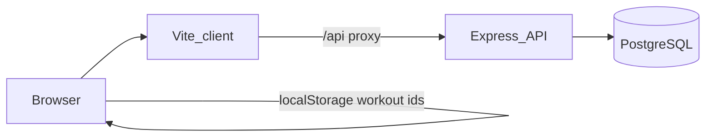

# Technical Architecture
Home Workout

Status: Draft v1.0
Companion to the product architecture. This document describes the system that is in the repository.

1. System shape

The repository is an npm workspace with two packages.

The client is a React 19 application in `client/`. Vite 7 serves it in development and builds the static files. Tailwind CSS 4 styles the screens. React Router 7 owns the routes.

The API is an Express 4 application in `server/`. It validates requests with Zod, reads and writes PostgreSQL 16 through Prisma 6, and listens on port 4000.

PostgreSQL runs from `docker-compose.yml` as the `home-workout-db` container. The database name, user, and password are `homeworkout`, and the host port is 5432. A named volume, `home_workout_pg`, keeps the data. If Docker is unavailable, a local Prisma Postgres process can stand in, with `DATABASE_URL` pointed at the URL it prints.

In development, the Vite server on port 5173 proxies `/api` to `http://localhost:4000`. The browser therefore calls the API on the same origin. `CORS_ORIGIN` defaults to `http://localhost:5173` and accepts a comma-separated list. `PORT` defaults to 4000. Both values, and `DATABASE_URL`, live in `server/.env`, copied from `server/.env.example`.

There is no authentication service and no production deploy configuration in this repository.

2. Local runtime

From the repository root:

- `npm run dev` starts the API and the client together.
- `npm run db:up` starts PostgreSQL.
- `npm run db:migrate` runs `prisma migrate deploy` in `server/`.
- `npm run db:seed` loads the catalogue. It can be run more than once.
- `npm test` runs the client and server Vitest suites.
- `npm run build` typechecks and builds both packages.
- `npm run lint` runs ESLint in both packages.

The API entry point is `server/src/index.ts`. It loads environment variables and calls `createApp()` from `server/src/app.ts`. Prisma Client is a single instance in `server/src/db.ts`. `postinstall` in the server package runs `prisma generate`.

3. Client

Routes, all inside the shared layout in `client/src/components/Layout.tsx`:

| Path | Screen |
| --- | --- |
| `/` | Home. Start a workout, reopen the saved draft, continue the started session, or open muscles, exercises, and meals. |
| `/workouts/new` | Workout builder. Muscle, goal, experience, equipment, and session length. |
| `/workouts/:id` | Saved plan, guided session, set log, and cooldown. |
| `/muscles` | Muscle groups in catalogue order, with exercise counts. |
| `/exercises` | Search and filters. |
| `/exercises/:slug` | Exercise detail, demonstration, and prescription cues. |
| `/nutrition` | Pre- and post-workout meal filters. |

`client/src/api.ts` exposes two helpers. `useApi` loads a GET path and reports loading, ready, or error, and it aborts the request when the path changes. `apiRequest` sends writes and throws the API error message, with the HTTP status attached. Screens use the shared loading, empty, and error states in `client/src/components/Status.tsx`.

The browser stores two workout ids in `localStorage`:

- `home-workout:draft-workout` is the last saved plan.
- `home-workout:started-workout` is the session the user started.
- `home-workout:last-workout` is read only as a fallback for an older draft key.

The id in the address is the only key to a saved workout. A link to `/workouts/:id` is enough to open that plan. Treat the link as private.

4. API

All routes are mounted under `/api/v1` in `server/src/app.ts`. Successful bodies use `{ data }`. Failures use `{ error: { code, message, details? } }`. Unknown `/api` paths return `404` with code `NOT_FOUND`.

Catalogue

- `GET /api/v1/muscles` returns muscle groups ordered by `sortOrder`, each with an exercise count.
- `GET /api/v1/exercises` filters by `search` (case-insensitive name match), `muscle`, `equipmentCategory`, `difficulty`, and `goal`. Results are ordered by name. `limit` defaults to 100 and caps at 100. `offset` defaults to 0. The body is `{ data, meta }`, and `meta` carries `total`, `limit`, and `offset`. List items omit instructions.
- `GET /api/v1/exercises/:id` accepts an id or a slug and returns description, instructions, an approved animation list, previous and next exercises by name, and a progression cycle for the exercise's first goal.

`equipmentCategory` is `free_weight`, `machine`, or `bodyweight`. `goal` is `strength`, `hypertrophy`, `general_fitness`, or `endurance`. `difficulty` is `beginner`, `intermediate`, or `advanced`.

Workouts

- `GET /api/v1/workouts/recommendations` takes `muscle`, `goal`, `experience`, `equipment`, and optional `length`.
- `POST /api/v1/workouts` saves a plan from the same fields plus the chosen exercise lines.
- `GET /api/v1/workouts/:id` returns the plan, warm-ups, exercises, set logs, and cooldowns.
- `PATCH /api/v1/workouts/:id` replaces the exercise lines of a draft.
- `POST /api/v1/workouts/:id/start` marks a draft as started.
- `POST /api/v1/workouts/:id/sets` logs one set.
- `PATCH /api/v1/workouts/:id/cooldowns/:cooldownId` completes, skips, retimes, or replaces a cooldown stretch.

`experience` is `beginner`, `intermediate`, or `advanced`. `equipment` on the recommendation query is a comma-separated list of equipment categories. `length` is `full` or `standard` and defaults to `full`.

Nutrition

- `GET /api/v1/nutrition/recommendations` takes optional `timing` (`pre` or `post`), `region` (`local` or `international`), `diet` (`vegetarian` or `vegan`), `exclude`, `budget` (`low` or `moderate`), `maxPrepMinutes`, and `goal`.

`exclude` is a comma-separated list of `milk`, `egg`, `peanut`, `fish`, `soy`, `gluten`, and `tree_nut`.

5. Session lifecycle

The builder asks for a recommendation, then posts the exercises the user kept. The server checks that every exercise still trains the chosen muscle as a primary muscle and that every piece of its equipment is in the allowed categories. It stores the goal, experience, equipment categories, rationale, estimated minutes, and round count. It attaches the warm-up stretches for that muscle and writes each exercise line with sets, reps, rest, and a short reason.

A plan starts as `draft`. `PATCH` is allowed only while the status is `draft`. After start, the status is `started` and `startedAt` is set. Starting a plan that is already started or completed returns the current plan.

Set logs are upserted on workout exercise, round, and set number. A log stores completed reps and an optional weight in kilograms. The set must belong to the plan, the plan must be started, and the round and set number must fall inside the saved prescription.

When the number of logs reaches rounds times the sum of sets, the server writes the cooldown and sets the status to `completed` with `completedAt`. The cooldown lists the session muscle first, then every other muscle linked to the exercises on the plan, ordered by muscle `sortOrder`. Each entry uses the gentle stretch for that muscle (`cooldown-{muscle}-gentle`) and starts as `pending`.

A completed plan can mark a pending stretch `completed` or `skipped`, change its hold between 20 and 90 seconds, or replace it with the other cooldown stretch for the same muscle. A stretch that is already finished stays finished.

6. Recommendation rules

`server/src/lib/recommend.ts` is a pure rules module. The route loads candidates and warm-ups, then passes that plain data in.

An exercise is eligible when it has the requested muscle as a primary muscle and every equipment category it uses is in the allowed set. An exercise with no equipment is left out.

Within a region, movement type and difficulty order the options. Strength prefers compounds. Hypertrophy treats compounds and isolation equally. General fitness prefers compounds, then isolation and isometric work. Endurance prefers isolation and isometric work. An exact difficulty match ranks above an exercise one step easier. Anything further away, including a harder exercise, gets no difficulty bonus.

The plan keeps one exercise per `region` of the muscle. Inside a region it prefers the same difficulty and the same goal, then the same difficulty, then the nearest difficulty that still matches the goal, then the nearest difficulty of any goal. The rationale names the muscle, goal, and equipment, calls out parts that had to use a different goal or a harder or easier exercise, lists the regions included, and names any region with no eligible exercise. It says these are general training rules. A `full` session is described as a long session.

Up to five alternatives are returned for each selected region, taken from the other eligible exercises in that region in score order.

Prescription before the session-length adjustment:

| Goal | Sets | Reps | Rest |
| --- | --- | --- | --- |
| Strength | 4 | 5 | 150 seconds |
| Hypertrophy | 3 | 8-12 | 75 seconds |
| General fitness | 3 | 10 | 60 seconds |
| Endurance | 3 | 15 | 45 seconds |

Duration assumes 45 seconds of work per set, the saved rest, 60 seconds between exercises, and 180 seconds between rounds, plus the warm-up. A `standard` session is one round at the goal prescription. A `full` session starts from that prescription and, while the estimate is under 90 minutes, adds a round when that round would still land at or under 120 minutes. Otherwise it adds rest in 15-second steps, up to 180 seconds. If the result is over 120 minutes, rest is lowered back toward the goal's rest, then rounds are removed, then sets are removed. Sets stay at 2 or more. The saved estimate is that duration in minutes.

7. Progression hints

`server/src/lib/progression.ts` suggests the next load. The saved sets, reps, and rest stay as written. The hint is advice on the response.

Clean-rep targets depend on experience and goal. Suggested jumps are 1 kg for beginners, 2.5 kg for intermediate trainees, and 5 kg for advanced compound work. Advanced isolation and isometric work use 2.5 kg. For a loaded exercise, the summary says to add that jump once every set reaches the clean-rep target. For a bodyweight exercise, beginners and intermediate trainees are told to add 1 or 2 clean reps, capped at the advanced target for that goal. Advanced bodyweight work is told to use a harder version. Both bodyweight summaries also mention the kilogram jump for anyone who adds a weight.

When a recommendation is built, the API looks at the 20 most recently updated started or completed plans for the same muscle, goal, and experience. For each exercise it keeps the newest of those plans that already has logs. If that earlier session recorded a weight, finished its expected sets, and every logged set reached the clean-rep target, the suggested weight is the last logged weight plus the jump. A recorded weight that did not earn the jump is repeated. With no recorded weight, the suggested weight is empty. The exercise detail page shows the clean-rep and jump cycle for every experience level, using the exercise's first goal and with no earlier logs attached.

8. Data model

The schema is `server/prisma/schema.prisma`. Identifiers are CUIDs. Catalogue rows also have unique slugs.

Catalogue

- `MuscleGroup` has slug, name, anatomical region, and sort order. The seeded groups are chest, back, shoulders, biceps, triceps, forearms, quadriceps, hamstrings, glutes, calves, and abdominals.
- `Equipment` has slug, name, and category `free_weight`, `machine`, or `bodyweight`.
- `Exercise` has slug, name, description, instructions, difficulty, movement type (`compound`, `isolation`, or `isometric`), a region string, and a `goals` array.
- `ExerciseMuscle` links an exercise to a muscle as `primary` or `secondary`.
- `ExerciseEquipment` links an exercise to equipment.
- `Stretch` has instructions, a hold in seconds, and purpose `warmup` or `cooldown`.
- `StretchMuscle` links a stretch to the muscles it serves.
- `ExerciseStretch` can link an exercise to a stretch with a relevance note. Seed and the current routes leave this table empty. Cooldowns are chosen from the muscles on the session.
- `AnimationAsset` belongs to an exercise or a stretch. Format is `lottie`, `video`, or `image`. Review status is `draft` or `approved`. The API returns approved assets only.

Session

- `WorkoutPlan` stores the muscle, goal, experience, equipment categories, rationale, estimated minutes, rounds, and status `draft`, `started`, or `completed`, plus `startedAt` and `completedAt`.
- `WorkoutExercise` stores order, sets, reps as text, rest seconds, and the reason string. Order and exercise are unique within a plan.
- `WorkoutWarmup` stores the warm-up stretches copied onto the plan.
- `WorkoutSetLog` stores round, set number, reps completed, and optional `weightKg`.
- `WorkoutCooldown` stores the stretch, the muscle, order, duration, and status `pending`, `completed`, or `skipped`. One cooldown row per muscle on a plan.

Nutrition

- `Food` has slug, name, region `local` or `international`, serving size, preparation, allergens, and diet tags.
- `FoodNutrient` stores `energy`, `protein`, `carbohydrate`, or `fat`, with amount, unit, and `sourceName`. One row per nutrient per food.
- `Meal` has timing `pre` or `post`, region, rationale, prep minutes, budget `low` or `moderate`, and emphasis `carbohydrate`, `protein`, or `mixed`.
- `MealFood` orders the foods inside a meal.

9. Catalogue and seed

Hand-written exercises live in `server/src/catalogue.ts`. `server/src/goal-patterns.ts` fills missing muscle, region, difficulty, and goal combinations from movement patterns. A generated slug looks like `{muscle}-{region}-{goal}-{difficulty}`. Beginner names are prefixed with "Supported" and advanced names with "Paused". Instructions are one text block: a `Setup:` line, numbered steps, a `Breathing:` line, and a `Common mistakes:` line.

Warm-ups live in `server/src/warmups.ts`. Each muscle has cooldown stretches in `server/src/cooldowns.ts`: a gentle hold and an easier alternative, both 30 seconds, with slugs `cooldown-{muscle}-gentle` and `cooldown-{muscle}-easier`. Foods and meals live in `server/src/nutrition.ts`.

`server/prisma/seed.ts` upserts muscles, equipment, exercises, stretches, foods, and meals by slug. It replaces each exercise's muscle links, equipment links, and animation row, and it replaces each food's nutrient rows. Exercises and stretches that are no longer in the catalogue are deleted. Each exercise and each cooldown stretch gets one animation row: `/demonstrations/{slug}.mp4`, format `video`, review status `approved`. Warm-ups are stored as text and have no animation row.

10. Demonstrations

`npm run demonstrations` in `server/` runs `server/src/demonstrations/render.ts`. With no argument it renders every exercise. `--cooldowns` renders the cooldown stretches. A single slug renders that exercise. Each clip is 20 PNG frames at 480 by 360 and 10 frames per second, encoded as H.264 with ffmpeg. Frames come from pose recipes in `server/src/demonstrations/pose.ts` and `server/src/demonstrations/draw.ts`. Output goes to `client/public/demonstrations`, so the client serves the files and the API stores the URL.

The player in `client/src/components/Demonstration.tsx` uses the first approved video. It offers play, pause, replay, and playback at 0.5, 1, and 1.5. The caption says the clip is an original illustration of the movement. If the instructions match the setup, steps, breathing, and mistakes pattern, those sections render on the page as well. If the video element errors, the player hides the video and leaves the text. Instructions that do not match the pattern render as plain preformatted text.

11. Nutrition rules

`server/src/lib/nutrition.ts` filters the seeded meals in memory. A meal must match the requested timing and region when those are set. A diet filter keeps a meal when every food carries that diet tag. An allergen filter drops a meal when any food lists an excluded allergen. Budget `low` keeps low-budget meals. A budget of `moderate`, or no budget, leaves every budget band in the list. `maxPrepMinutes` drops slower meals.

Ranking uses emphasis only for some goals. Endurance prefers carbohydrate, then mixed, unless the request is specifically post-workout. Strength and hypertrophy prefer protein, then mixed, unless the request is specifically pre-workout. Other queries keep catalogue order.

A nutrient number is returned only when `sourceName` is non-empty. Every response includes: "These meals are general guidance. They are not a medical diet or a guarantee of performance."

The nutrition screen writes the same filters into the query string and renders serving size, preparation, and any published nutrients.

12. Errors and validation

Zod failures return `400` with code `VALIDATION_ERROR` and the issue list. Application errors use `HttpError` with an HTTP status and a code. Missing muscles, workouts, and stretches return `404` with `NOT_FOUND`. Editing a started workout, logging a set before start, and changing a cooldown before the workout is complete return `400`. A database the process cannot reach returns `503` with code `DATABASE_UNAVAILABLE`. Anything else is logged and returned as `500` with code `INTERNAL_ERROR` and the message "Something went wrong."

Workout writes also reject an empty exercise list, more than 16 exercises, duplicate exercises, reps outside 1 to 50, inverted rep ranges, rest outside 15 to 300 seconds, and sets outside 1 to 10.

13. Tests

Server tests use Vitest and Supertest against `createApp()`. They cover the catalogue, recommendations, workout save and logging, cooldowns, nutrition, and the HTTP error envelope. Recommendation, progression, cooldown ordering, and nutrition ranking also have unit tests beside the modules.

Client tests use Vitest, jsdom, and Testing Library. They cover the home page, muscle and exercise browsing, exercise detail, the builder, the workout page, the nutrition page, the demonstration player, and the guided session.

14. Boundaries of this build

This build is a single-user local application. Workout identity is the plan id. The home page can reopen the draft id and the started id stored in that browser.

The product areas left for later are a progress screen with server-side history, settings, accounts, a deployment pipeline, AI coaching, pose estimation, wearables, social features, subscriptions, and clinical nutrition or rehabilitation plans. `ExerciseStretch` is reserved in the schema for a future direct exercise-to-stretch link. Animation formats other than video are reserved in the enum. The player publishes video assets.
